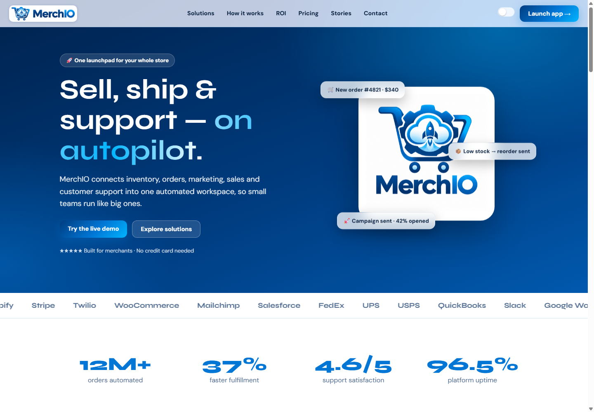
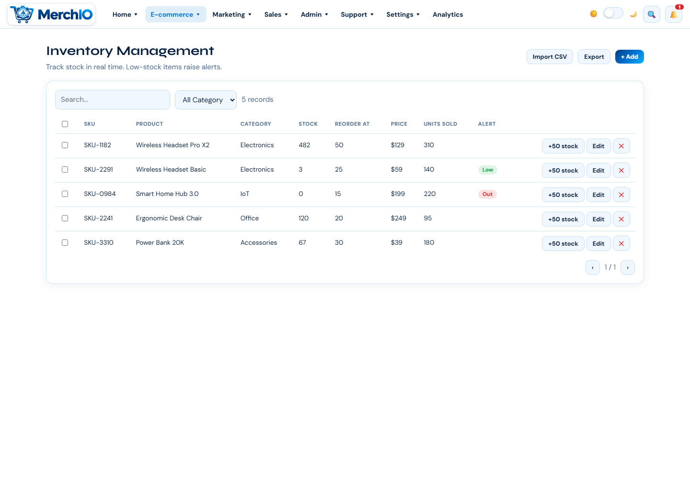
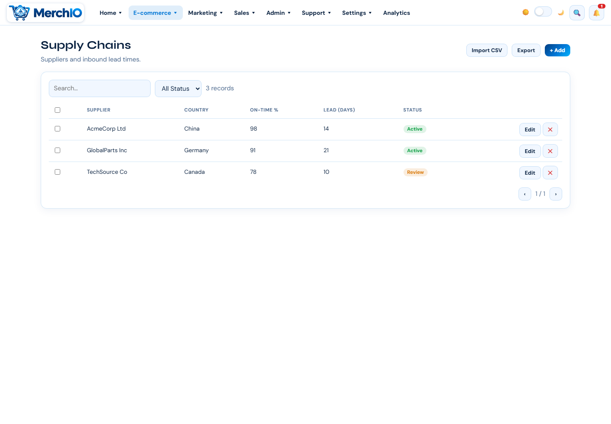

# MerchIO

**One connected workspace for commerce operations.** MerchIO is a proposed platform for small and midsize merchants to manage inventory, orders, customer support, marketing, and connected workflows.

This package brings together the product brief, architecture and data/API designs, roadmap, source plans, and the supplied web, desktop, and mobile prototypes. The formal documents and implementation plan are drafts; the included UI is prototype software, not a production service. Prototype metrics, actions, plans, and integrations may be simulated and must not be interpreted as live business data or operational guarantees.

## What’s inside

- [Project overview](docs/index.md), [product requirements](docs/prd.md), [architecture](docs/architecture.md), [API design](docs/api-design.md), [data model](docs/data-model.md), and [roadmap](docs/roadmap.md).
- [Architecture diagram](docs/assets/architecture.svg) and [data model diagram](docs/assets/data-model.svg).
- [Prototype showcase](#prototype-showcase) and source files under `src/`.
- Original working drafts and the readiness audit under `src/backend plan/source-materials/`.

## Prototype showcase

| Landing / dashboard prototype | Product catalog prototype | Supplier view prototype |
|---|---|---|
|  |  |  |

These are screenshots of the supplied browser prototype. Sample records and displayed values are illustrative; the supplier view is a supply-chain screen, not a live vendor portal.

## Build the documentation site

```bash
python -m pip install mkdocs
mkdocs build --strict
mkdocs serve
```

The GitHub Actions workflow checks the required package files and performs the same strict documentation build on pushes and pull requests.

## Status and scope

MerchIO is at the prototype and planning stage. The architecture and API describe a proposed production system; no production backend, authentication, tenant isolation, payment processing, or live messaging service is included in this documentation package. See the [roadmap](docs/roadmap.md) and [readiness audit](src/backend%20plan/source-materials/MerchIO_Readiness_Audit.md) before treating any proposed capability as delivered.

## License

No license is declared in the supplied project materials. Obtain the project owner’s decision before redistributing or reusing this package.
