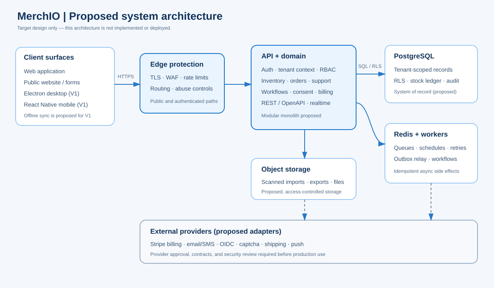

# Architecture

**Status:** proposed target architecture synthesized from the supplied backend plan and architecture draft. It is not an implemented or deployed system. Framework versions, hosting provider, ORM, identity approach, and some external integrations remain subject to technical spikes and owner decisions.

## Architectural goals

1. Enforce workspace boundaries and permissions consistently across clients.
2. Keep order and stock transitions correct under concurrency.
3. Define business rules once and reuse them across API, workers, and clients.
4. Process workflows, imports, notifications, and scheduled sends reliably.
5. Add desktop/mobile offline support without making clients the authority.
6. Deliver a broad product through a maintainable modular monolith before considering service extraction.

## Proposed system view

| Component | Proposed responsibility |
|---|---|
| Web client and public site | Primary user experience and public lead forms; clients call authenticated or explicitly public API routes |
| Desktop and mobile clients | Proposed V1 clients with secure token storage, local cache, and queued offline mutations |
| Edge layer | TLS termination, WAF, abuse controls, and routing |
| API | Authentication, tenant context, authorization, validation, domain actions, OpenAPI, and realtime notifications |
| Shared domain package | Canonical schemas, validation, and business rules reused by API and workers |
| PostgreSQL | System of record; tenant-scoped data, transactional outbox, audit events, and stock ledger |
| Redis and workers | Queues, rate limits, retries, workflow runs, imports, schedules, and provider callbacks |
| Object storage | Proposed storage for bounded, scanned imports, exports, and attachments |
| External providers | Proposed adapters for payment, email, identity, captcha, shipping, SMS, and push |

The recommended implementation is a TypeScript modular monolith (the source plan names NestJS/Fastify) with PostgreSQL row-level security, Redis/BullMQ workers, and a REST/OpenAPI contract. The exact framework, ORM, cloud, and identity-provider choice must be recorded as approved architecture decisions before production implementation.

## Module boundaries

Organize the application around domain ownership: identity/workspaces, team and permissions, billing/entitlements, inventory, orders, marketing/consent, sales, support, workflows, notifications, settings, analytics, public forms, files, and sync. Modules should coordinate through explicit services and domain events rather than directly modifying each other’s tables.

Keep the first deployment as one API and independently scalable worker processes. Split a module into a separate service only when measured scale, isolation, or team ownership justifies the operational cost.

## Trust and request flow

For a protected write, the proposed API should authenticate the actor, derive the workspace from a verified membership/session, set tenant context for the database transaction, authorize the requested action, validate the payload, and invoke a domain operation. The operation writes state, audit information, and an outbox event in one transaction. Workers process external effects asynchronously with idempotency and bounded retries.

Never trust a client-supplied tenant identifier as authority. Apply application authorization and database row-level security as separate controls; test cross-tenant access negatively. Public lead forms need isolated routes, rate limits, validation, bot protection, and minimal collection.

## Critical runtime flows

### Fulfill an order

Lock the order and affected product rows in a stable order; check every line before changing anything. In one transaction, update the order, decrement stock, append stock movements, record audit data, and write outbox events. Reject insufficient stock without partial updates. Use optimistic version checks and an idempotency key so concurrent or repeated requests cannot duplicate effects.

### Run a workflow

Commit domain changes and outbox events together. A relay publishes unprocessed events; workers match active workspace workflows, deduplicate runs by workflow and event, record each step, and retry transient failures with bounded backoff. Exhausted jobs go to a dead-letter queue and surface to operators.

### Schedule communications

Claim due work safely across workers. Before sending, recompute eligible recipients from current consent and suppression state, enforce applicable quiet hours and caps, and use provider idempotency where available. Verify webhook signatures and replay behavior. No campaign send is represented as live in the current prototype.

## Data consistency and realtime

Use the database transaction as the boundary for business state. The outbox decouples durable state changes from notifications and background work. Realtime messages should tell clients that data changed; clients then fetch authorized state. For future sync, use monotonic change sequences, mutation IDs, base versions, and explicit conflict responses. Stock, order status, and entitlements remain server-authoritative.

## Quality attributes to verify

The source plan proposes p95 API latency below 300 ms, 99.9% availability, a five-minute recovery-point objective, and one-hour recovery-time objective. These are targets only, not current service levels. Validate with load tests, failure exercises, backups, restore drills, and operational monitoring before making a service commitment.

## Architecture decisions and open items

- Approve modular-monolith boundaries and extract shared domain rules from client prototypes.
- Select ORM/migration tooling and identity approach through short recorded spikes.
- Decide cloud provider, region, data residency, retention, and backup locations.
- Verify desktop/mobile runtime versions, secure storage, packaging, and offline conflict strategy.
- Establish observability, incident response, and provider sandbox testing.

The [data model](data-model.md) and [API design](api-design.md) expand the proposed contracts. The original architecture and implementation drafts remain under `src/backend plan/source-materials/`.
