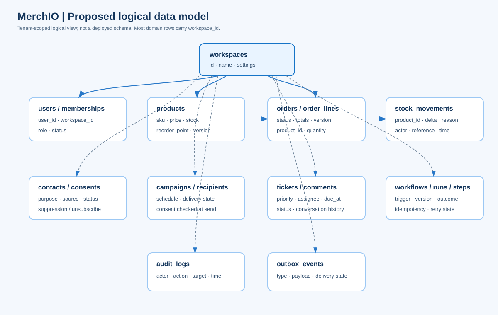

# Data model

**Status:** proposed logical model synthesized from the supplied SRS and architecture drafts. This is not a deployed schema or migration set. Exact columns, retention periods, indexes, and privacy constraints require technical and legal review.

## Modeling principles

- Use an immutable tenant/workspace ownership key on tenant data, set from authenticated server context.
- Enforce tenant separation in authorization and PostgreSQL row-level security; include tenant keys in uniqueness constraints and leading list indexes where appropriate.
- Use integer minor units with an ISO currency code for money. Avoid floating-point arithmetic for stored totals.
- Use explicit status enums/state machines and optimistic `version` fields for concurrent updates.
- Record inventory deltas in an append-only movement ledger; treat the product stock balance as a transactionally maintained projection.
- Store audit and outbox records separately from mutable business entities, with narrow write permissions and retention controls.
- Soft-archive referenced business records rather than silently deleting history.

## Proposed entity groups

| Domain | Entities | Relationships and constraints |
|---|---|---|
| Identity | `workspaces`, `users`, `memberships`, `roles`, `sessions`, `devices` | Membership links user to workspace and role; session-derived workspace context |
| Billing | `plans`, `subscriptions`, `entitlements`, `usage_records`, `invoices` | Workspace subscription controls limits; provider event IDs deduplicated |
| Commerce | `products`, `stock_movements`, `orders`, `order_lines`, `suppliers`, `shipments` | Order lines reference products; each stock change has actor, reason, quantity, and reference |
| Customer and marketing | `contacts`, `consents`, `campaigns`, `campaign_recipients`, `suppressions` | Consent and suppression determine send eligibility at execution time |
| Sales | `leads`, `accounts`, `deals`, `activities` | Workspace-scoped identities and references; uniqueness rules need domain confirmation |
| Support | `tickets`, `ticket_comments`, `sla_policies` | Ticket has priority, assignee, status, and server-calculated due time |
| Automation | `workflows`, `workflow_versions`, `workflow_runs`, `workflow_steps` | Runs are idempotent per workflow/event; steps record outcome and retry state |
| Platform | `notifications`, `audit_logs`, `outbox_events`, `tenant_modules` | Append-only audit and transactional outbox; module switches are workspace-scoped |

## Core relationships

- One workspace has many memberships; a user may belong to multiple workspaces through memberships.
- A workspace has many products and orders. An order has one or more order lines; each line references a product.
- A product has many stock movements. Movement history is the explanation for the current balance.
- A workspace has many workflows and workflow runs; a run contains ordered step results.
- A ticket has comments and an optional assigned membership.
- A workspace has audit, notification, and outbox records. Access to these records follows explicit role and data-retention policy.

## Order and inventory state

Proposed order states are `pending`, `processing`, `fulfilled`, and `cancelled`. Allowed transitions should be explicit and enforced by a domain command. Fulfillment must check all lines and apply stock movement, balance, order status, audit, and outbox updates in one database transaction. If a line cannot be fulfilled, the entire operation fails without partial stock changes.

Cancellation of an order that already consumed stock must restore only the quantities actually applied for that order. Never infer reversals from a current product balance; reference the original movements and record compensating movements.

Proposed `stock_movements` fields include `id`, `workspace_id`, `product_id`, `quantity_delta`, `reason`, `reference_type`, `reference_id`, `actor_id`, and `created_at`. The product balance must not become negative. Low-stock events should fire only when a movement crosses the configured reorder threshold from above.

## Indexing and integrity

Candidate constraints and indexes:

- Unique `(workspace_id, normalized_sku)` for active products.
- Unique `(workspace_id, order_number)` using a transactionally allocated counter.
- Index `(workspace_id, status, created_at)` for common order and ticket queues.
- Index `(workspace_id, product_id, created_at)` for movement history.
- Index `(workspace_id, occurred_at)` for audit and event queries.
- Foreign keys and check constraints for valid quantities, currency codes, and status values.
- Idempotency uniqueness scoped to tenant, actor or route as appropriate.

Finalize indexes from query plans and data volume, not assumptions. Partitioning and long-term archival are operational decisions that must be backed by retention and restore requirements.

## Audit, outbox, and sync

Write an outbox event in the same transaction as the business change; workers claim and mark events for delivery with retries. Audit records should be append-only to application roles and include actor, workspace, action, target, request ID, result, timestamp, and a minimal change summary. The draft architecture proposes a chained hash for tamper evidence; this is not a substitute for access controls, protected backups, or independent audit review.

For a future offline client, maintain a monotonic change sequence and a mutation ID per client operation. Replays return the original result. Conflicts on stock, order state, and entitlements are server-authoritative and require an explicit user-visible resolution rather than last-writer-wins.

## Privacy and retention

Classify credentials and integration tokens as restricted; customer, order, ticket, and consent data as confidential. Encrypt transport and sensitive stored secrets, scrub logs, define retention per record category, and implement access/export/deletion processes with audit evidence. The final retention schedule, lawful bases, residency, and deletion exceptions remain open for legal review.
