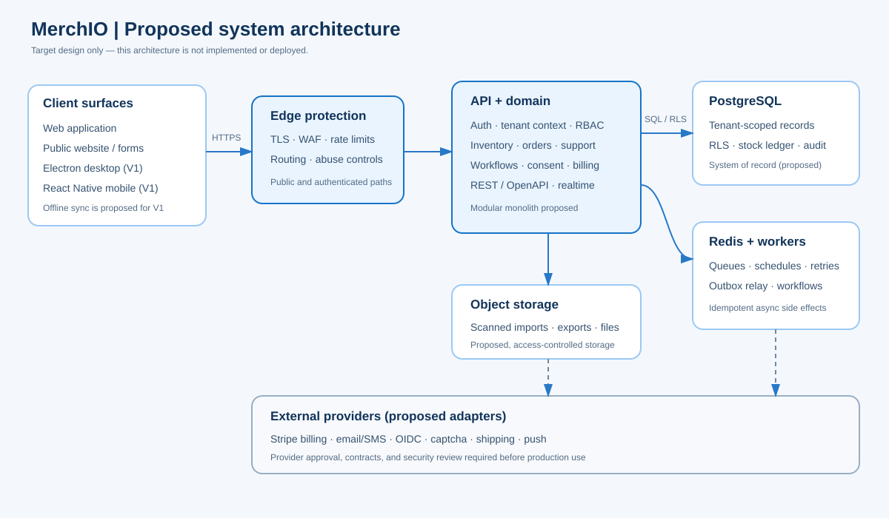

# MerchIO

MerchIO is a **proposed commerce-operations platform** intended to connect a merchant’s inventory, order handling, customer support, marketing, and reporting in one workspace. The product vision is to reduce disconnected tools and make routine work easier to coordinate.

> **Project status:** prototype and draft planning. The supplied web, desktop, and mobile artifacts demonstrate interface concepts and local behavior. They are not a production service. This site describes intended capabilities and proposed designs unless an item is explicitly identified as existing prototype behavior.

## The product idea

A connected workflow could link the operational events that merchants now manage separately: an order is fulfilled, inventory is adjusted, a low-stock condition is detected, and the right staff member receives a follow-up. MerchIO aims to make that connected loop understandable to small teams without requiring an in-house IT department.

The initial product proposal focuses on:

- Workspace access, roles, and settings.
- Product catalog, stock records, and order processing.
- Notifications, support tickets, and basic workflow automation.
- Consent-aware email campaign management and an operational dashboard.

Later phases propose desktop and mobile clients with offline synchronization, followed by additional sales, supply-chain, and integration capabilities. The [product requirements](prd.md) explains the personas, MVP boundary, success measures, and unresolved owner decisions.

## Proposed technical approach

The planning documents recommend a TypeScript modular monolith, a REST/OpenAPI contract, PostgreSQL with tenant isolation, background workers, and a shared domain package. These are recommendations awaiting review and implementation—not evidence that the services exist today. See the [architecture](architecture.md), [API design](api-design.md), and [data model](data-model.md).

## Prototype showcase

The project README includes the three requested screenshots captured from supplied prototype HTML. They contain seeded/demo content and should be presented as interface concepts, not live analytics or a production vendor portal.

## Source material

`src/frontend/` contains the provided browser prototypes and the original desktop/mobile source archives. `src/backend plan/source-materials/` preserves the supplied PRD, SRS, architecture, security and threat-model drafts, backend implementation plan, documentation plan, security rules, and readiness audit. The original source documents are marked draft or in review; they have not been treated as approved requirements.

## Delivery state

There is no production backend or operational deployment in this package. Authentication, role enforcement, database-level tenant isolation, provider integrations, billing, reliable job execution, and privacy/compliance workflows remain implementation and verification work. The [roadmap](roadmap.md) frames that work as proposed delivery phases and release gates.
